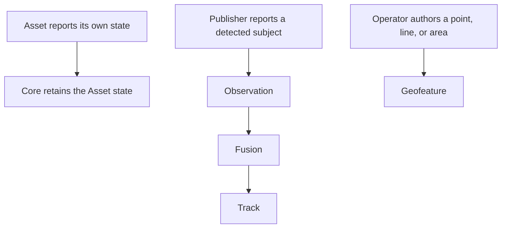

# Entities

## Story

I see field systems, their detections, and authored places. I can follow a target
without confusing source evidence with Atlas's shared picture.

## Flow

## Selected direction

- An Asset is a reporting system that can execute supported commands.
- An Observation is one publisher's continuing record of a detected subject.
- Fusion owns Track identity, associations, and derived state with source provenance.
- A Geofeature is authored geometry. The Asset decides how edits affect its execution.
- [Entity history](history.md) is maintained automatically inside Core.

Additional preset Tags are added as uses arise; their vocabulary is not fixed here.

## Asset deletion

The selected rule blocks deletion while an Asset's Tasks are unfinished. The
deletion check and new Task assignment must not race past one another.

Proposed for owner approval: completed, failed, and confirmed-cancelled outcomes
count as finished. Pending cancellation and uncertain execution do not.

Deletion preserves historical identity and records until Reset. It does not stop
physical work. [Result delivery after deletion](../objects/README.md#proposed-delivery-after-deletion)
is a separate proposal.

## Open

Fusion beyond the one-to-one starting policy requires its own story.

[Subsystem planning](../README.md)
