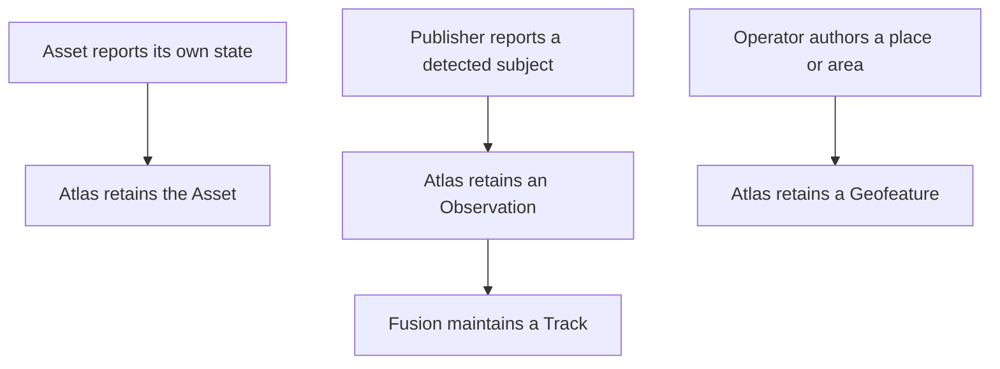

# Entities

## Story

I open Atlas and see the systems in the field, what they have detected, and the
places we have drawn. I can distinguish a reporting system from its observations
and from Atlas's shared picture of a target.

## Flow

## Read one kind at a time

| Kind | What to review |
| --- | --- |
| [Assets](assets/README.md) | Reporting systems, contact, and their own state |
| [Observations](observations/README.md) | One publisher's continuing evidence about a subject |
| [Tracks](tracks/README.md) | Shared target identity and derived state |
| [Geofeatures](geofeatures/README.md) | Authored points, lines, and polygons |

Each kind has its own page. Shared component fields, reporting, and history are
linked from the relevant page rather than repeated in each one.
