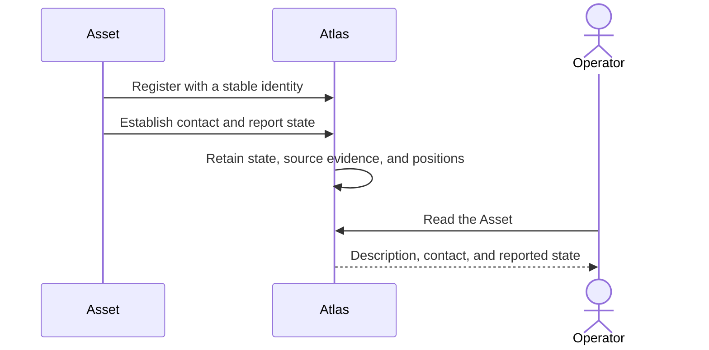

# Assets

## Story

I bring a drone or tracker into Atlas. I can see what it is, what it supports,
whether it is in contact, and the state it last reported.

## Flow

## Retained decisions to review

- Contact freshness and measurement age are different facts. A new packet does not make an old measurement new.
- A reconnect keeps the Asset identity. Replacing its running process is a separate action.
- The Asset executes physical work; Atlas records what the Asset reports.

## Details when needed

- [Messages](../../reference/current-design/entities/assets/messages.md) and [contact](../../reference/current-design/entities/assets/contact.md).
- [Asset components](../../reference/current-design/entities/assets/components/README.md).
- [Reporting](../../reference/current-design/entities/reporting/reports.md) and [position history](../../reference/current-design/entities/history/positions.md).

[Entities](../README.md)
