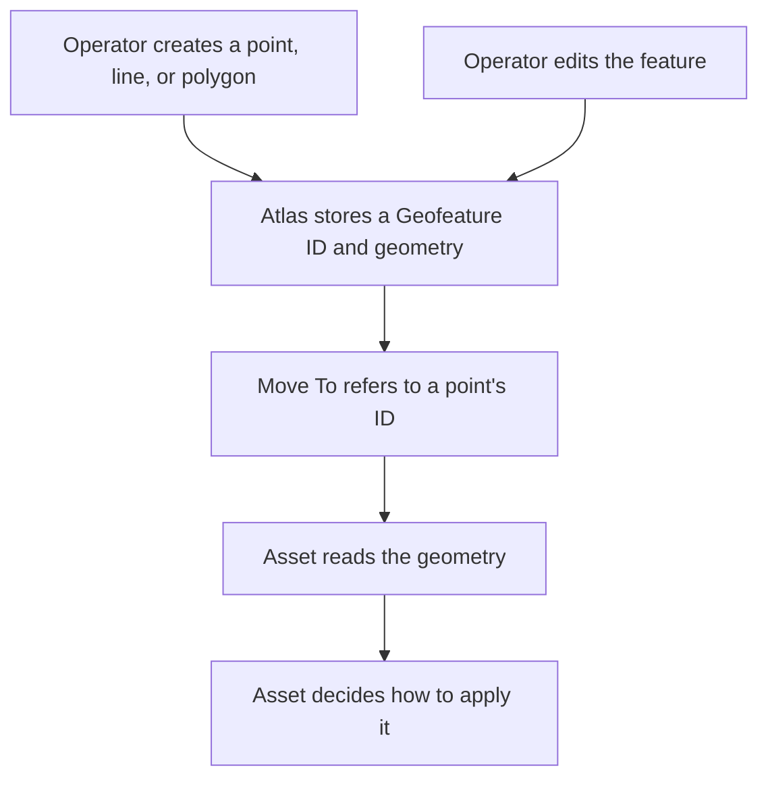

# Geofeatures

## Story

I save a waypoint and use it in a Move To Task. I can edit the waypoint without
creating a different place each time. Routes and areas can also be saved for planning.

## Flow

## Retained decisions to review

- Editing geometry keeps the Geofeature ID and advances its geometry revision.
- Move To accepts Point geometry. Saving a route or area does not make it executable.
- Saving an edit does not prove the Asset applied it. The Asset reports that evidence separately.
- Relevant nonterminal Tasks can block deletion of a referenced Geofeature.
- A purpose such as route or search area is descriptive. It does not start work or enforce a boundary.

## All Geofeature details

- [Create, read, edit, and delete](../../reference/current-design/entities/geofeatures/messages.md).
- [Geometry](../../reference/current-design/entities/geofeatures/geometry.md), [purpose](../../reference/current-design/entities/geofeatures/type.md), and [Task references](../../reference/current-design/entities/geofeatures/references.md).
- [Shared Entity fields](../../reference/current-design/entities/structure.md#component-composition) and [spatial conventions](../../reference/current-design/entities/structure.md#spatial-conventions).

[Entities](../README.md)
