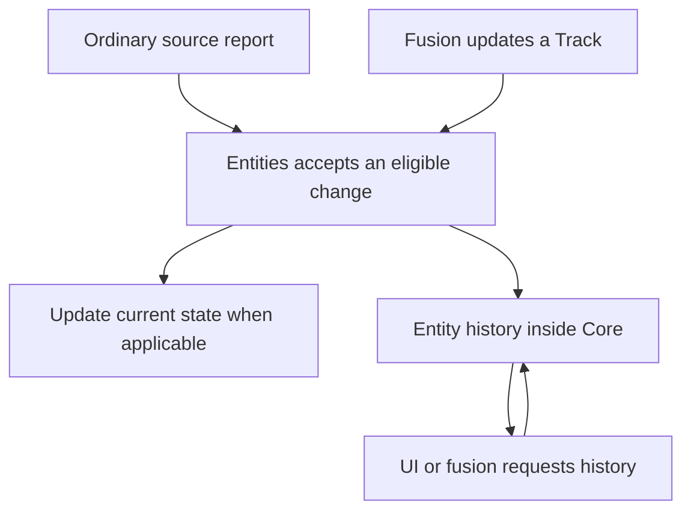

# Entity history

## Story

After a flight, I ask where an Asset or Track has been and what Atlas knew about
a detected subject. The Asset reported once, without a second history API.

## Flow

## Selected direction

- History belongs under Entities, with its own contained responsibility inside Core.
- It covers Assets, Observations, and Tracks, including fusion-produced Track changes.
- Location history includes height when reported. A horizontal breadcrumb trail is insufficient.
- Entities automatically maintains history for eligible accepted changes, regardless of producer. Sources do not submit separate history reports.
- If authored changes are selected for history, they use this same internal path.
- Edge clients normally use current information. Historical transfer happens only on request and must not congest the live path.
- Source identity and original measurement time remain distinguishable from receipt time.
- A late report with an older position is retained in history and does not replace the newer current position.

## Open

Historical fields beyond the selected location coverage, authored-edit coverage,
and corrections still need agreement. This does not select every typed Entity
change for retention. Storage and transaction choices belong to Core.

Existing publisher-state recovery constraints remain an accepted limitation.
Losing that state may prevent continuing the same Observation; integrations must
make replacement behavior visible.

[Entities](README.md)
