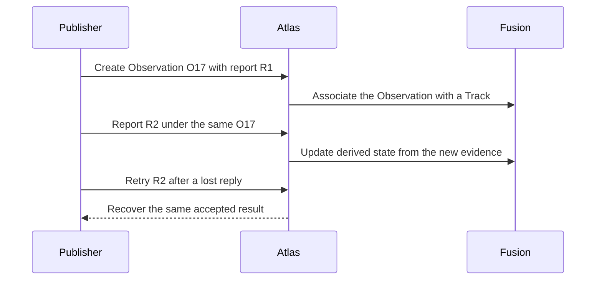

# Observations

## Story

A drone detects a vehicle and keeps reporting where it sees it. I want that to be
one continuing source record, with the drone's original evidence preserved.

## Flow

## Retained decisions to review

- The Observation belongs to its publisher. A gateway or credential change does not create a new publisher.
- A new report updates the continuing Observation. Retrying a report creates no second effect.
- Source identity, measurement time, and evidence stay distinct from derived Track state.
- Silence does not delete the record. The previous design retains it until Reset.

## Details when needed

- [Identity and lifetime](../../reference/current-design/entities/observations/observations.md).
- [Messages](../../reference/current-design/entities/observations/messages.md) and [evidence admission](../../reference/current-design/entities/reporting/evidence.md).
- [Tracks](../tracks/README.md).

[Entities](../README.md)
