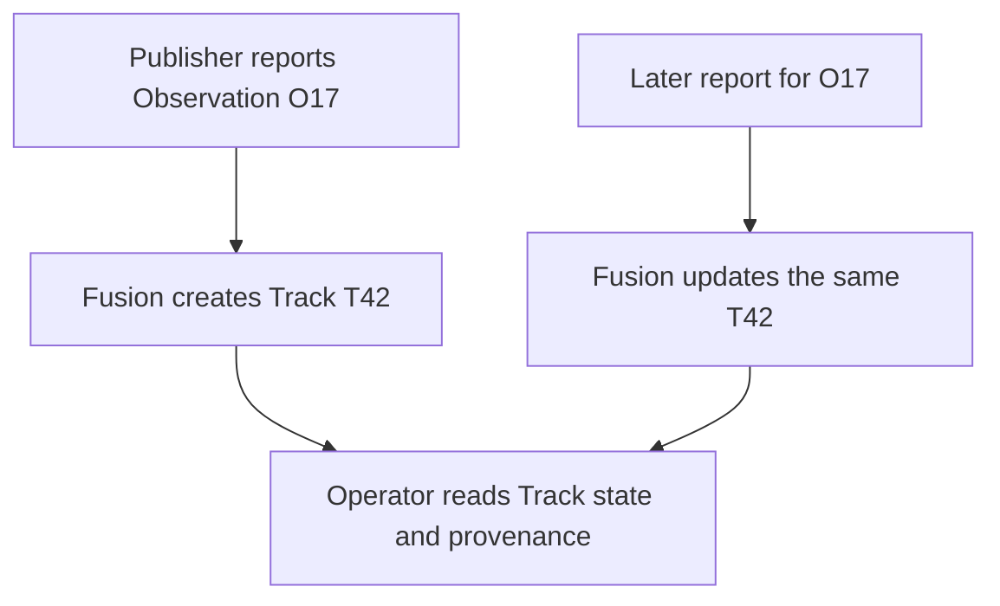

# Tracks

## Story

I follow a detected target in Atlas. Its Track gives me a stable shared identity
and shows which source observations support what I am seeing.

## Flow

## Retained decisions to review

- The initial policy is one Track per Observation. Two publishers seeing the same vehicle initially produce two Tracks.
- Assets report Observations. Fusion owns the shared Track association and derived state.
- Silence preserves the Track and its last-known evidence until Reset.
- More capable fusion is a later design. It must not silently change what an accepted Task targets.

## Details when needed

- [Track rules](../../reference/current-design/entities/tracks/tracks.md).
- [Fusion ownership](../../reference/current-design/entities/tracks/fusion.md) and [messages](../../reference/current-design/entities/tracks/messages.md).
- [Observations](../observations/README.md).

[Entities](../README.md)
