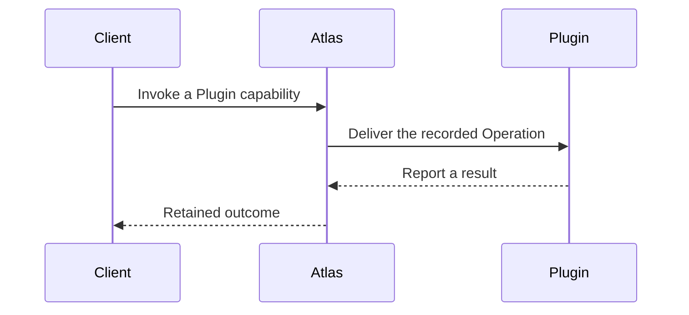

# Plugins

## Story to decide

I add an elevation lookup capability to Atlas and ask it for the ground elevation
at a position. Adding or replacing that capability should not require rebuilding
the Entity, Task, or Object systems.

This is an example from the earlier design, not an approved Plugin requirement.

## Earlier flow to review

## Decisions still open

- Does Atlas install, start, and stop plugins, or connect to independently managed programs?
- Do we want the earlier durable Operation model, or a smaller invocation model?
- What should a plugin be allowed to do through each pillar's interface?

## Earlier design, not approved

The [historical index](../reference/earlier-plugin-design/README.md) contains the
Plugin host, private runtime, Operation contract, messages, and manager recovery.
Its process model and implementation choices are not selected for the new system.

[Atlas planning](../README.md)
