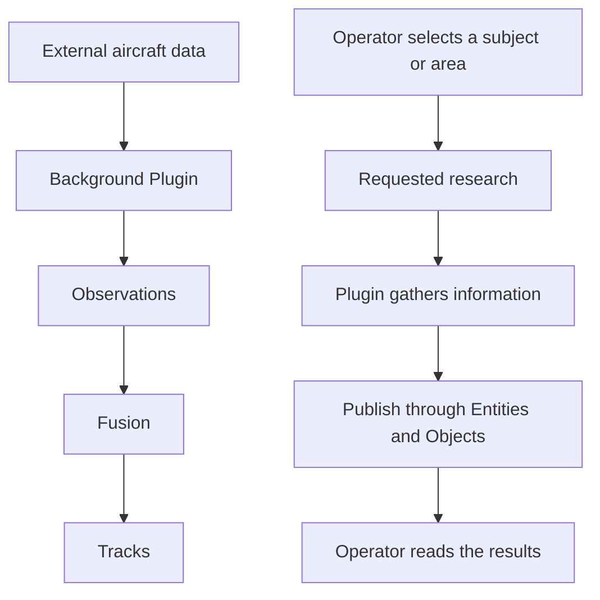

# Plugins

## Stories

An ADS-B plugin repeatedly reads an external source and publishes aircraft information
into Atlas. I see continuing detections rather than a new aircraft at every refresh.

I select a building or an area and request research. The plugin gathers useful
information, and I can find its results in Atlas afterward.

## Flows

## Selected direction

- Plugins acquire, analyze, and publish information. They may read Core data.
- Publishers create Observations; fusion owns Track association and derived state.
- They do not manage Assets or issue Tasks to them in the current build.
- Entities and Objects own published operational data, which survives Plugin shutdown.
- Plugins are a replaceable pillar owning extension behavior and only the invocation metadata a story selects. They need no dedicated database, supervisor, or durable job platform.
- With equal-permission testing keys, this intended role is not a credential restriction.

## Open

Installation, process supervision, request/status records, cancellation, and retry
behavior need agreement. Independently managed processes remain one proposal.
The earlier durable Operation platform is not automatically selected.

[Subsystem planning](../README.md)
