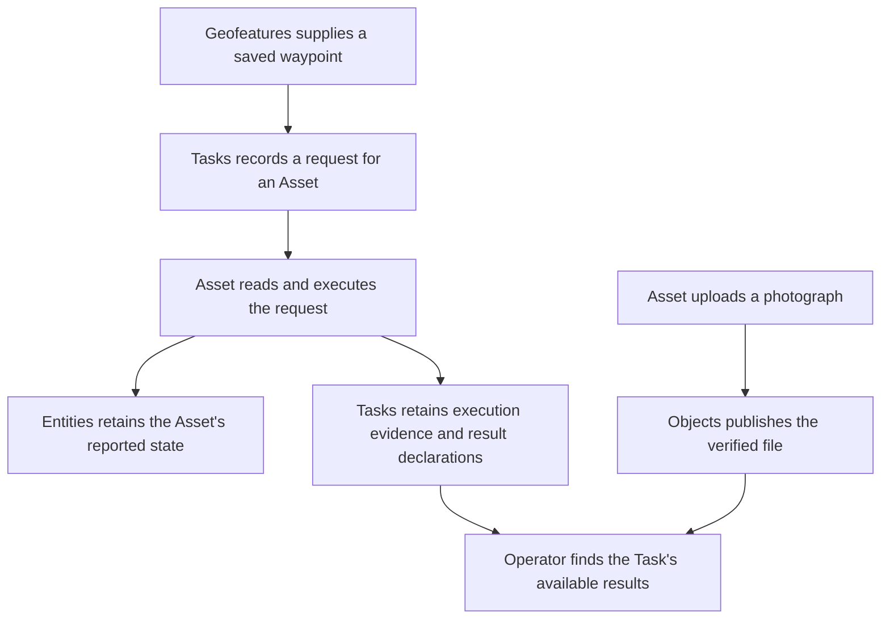

# How the systems work together

## Story

I choose a saved waypoint, ask a drone to go there, and later open the resulting
photograph. I should be able to explain that workflow without knowing the database.

## Flow

## Boundary to design

Each pillar owns its data and operations. Another pillar calls an explicit
interface rather than editing its tables. Sharing a database need not mean sharing
every implementation detail.

We still need to choose which cross-system changes must succeed together. The old
design has one broad commit boundary for resource changes, history, retry records,
and synchronized-picture effects. That is a decision to review, not an automatic
requirement for the rebuild.

The [previous shared rules](../reference/current-design/shared/README.md) preserve
that commit model, synchronization, requests, transport, and bounds for consultation.

[Atlas planning](../README.md)
