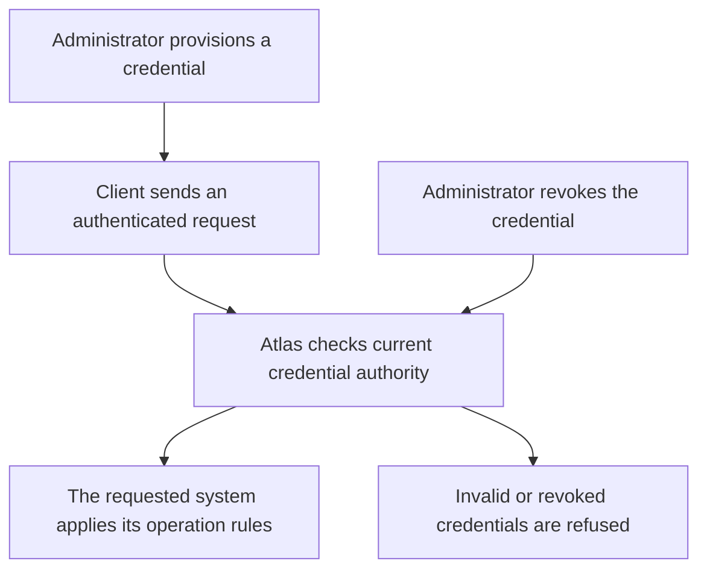

# Authentication

## Story

I give a client a credential so it can use Atlas. I can revoke that credential
without changing the identities of the Assets or observations it previously reported.

## Flow

## Retained decisions to review

- Credential identity is separate from Asset and publisher identity.
- The current design gives valid API keys equal API permissions. Operator profiles provide attribution, not a role hierarchy.
- Revocation stops new authorized network work. It does not undo already committed effects.

## Details when needed

- [Identity and credentials](../reference/current-design/support/identity.md).
- [Operator profiles](../reference/current-design/support/operators.md).
- [Client behavior after authorization loss](../reference/current-design/support/authorization-recovery.md).

[Supporting facilities](README.md)
