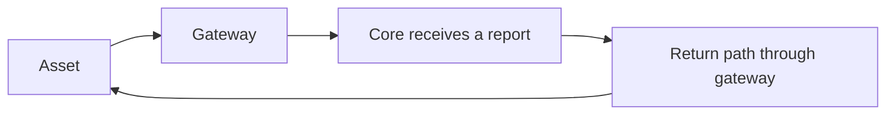

# Initial subsystem choices

## Story

The [central operating environment](https://github.com/atlas-field-systems/atlas/blob/main/environment.md)
explains field links, deployment, and the current testing phase.
These choices and open questions concern subsystem behavior within that context.

## Selected direction

- This is currently a short-run testing system. Keeping records until Reset is acceptable.
- Valid API keys have equal public-API permissions during this phase. Participants are trusted; a Plugin's intended role is not a credential restriction.
- Five seconds and one hour of disconnection use the same movement-request lifetime policy.
- Software updates may require Reset. Interrupted uploads may restart from zero. Core recovery may remain manual.
- Sensor-reference and uncertainty extensions remain deferred initially.

## Read a gateway-connected field link correctly

A received report, the age of its measurements, and proven two-way contact are
different facts. Buffered telemetry must not imply current command reachability.

## Open

Contact proof, clock assumptions, and acceptable round-trip delays need a field-path
story. Behavior when the gateway is reachable but Core is not also needs a decision.

[Subsystem planning](../README.md)
