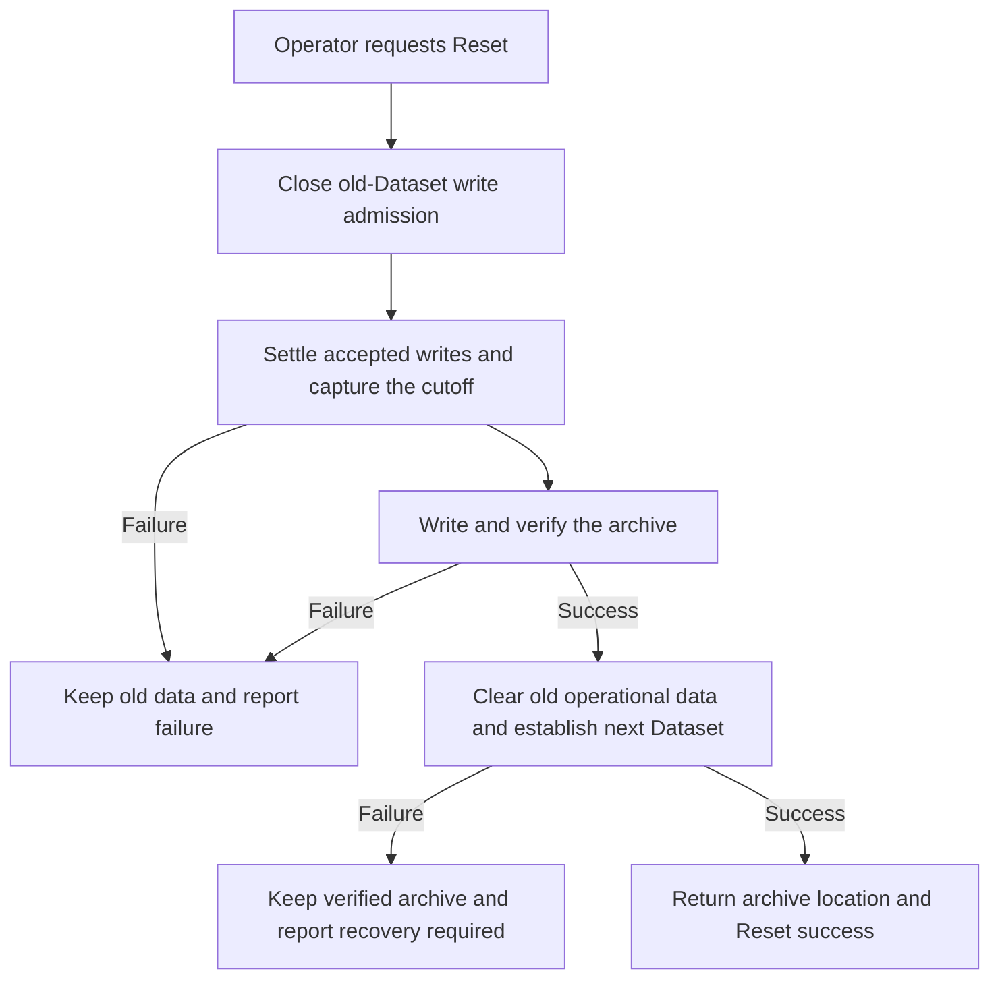

# Operating a run

## Story

I operate Atlas for a few hours, retain what happened, and Reset for the next run.
Reset gives me a ZIP of the run's operational history, not just its final state.

## Selected direction

- Keep operational records until Reset for the current short-run scope.
- Restart preserves data. Reset ends its operational lifetime.
- Updates may require Reset. Automatic Core recovery is not required initially.
- Produce the ZIP before clearing the old run. The [inventory](archive.md) is proposed.

## Proposed Reset flow

The detailed flow and failure rules below need owner approval.

Close old-Dataset write admission before choosing the cutoff. Settle already
accepted writes, then capture. Keep admission closed through capture, archiving,
and clearing, so no accepted old-Dataset change falls outside the archive.

Write and verify the ZIP outside the data being cleared before any destructive step.

If capture, writing, or verification fails, retain the old data and report failure.
An unavailable archive destination or insufficient space does not justify deletion.

Interrupted clearing never discards the verified archive or reports an unverified
Reset as successful. Report the archive location when available.
Resuming old-Dataset writes invalidates the cutoff. A later Reset needs a fresh archive.

## Open

Recovery mechanics, when admission can reopen, and whether one Dataset equals one
run remain open. Archive restore is not selected.

[Subsystem planning](../README.md)
