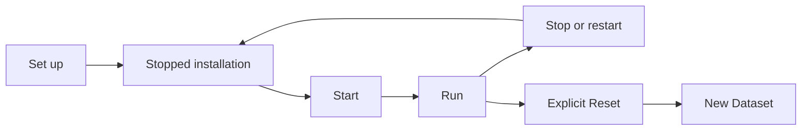

# Operating an installation

## Story

I set up Atlas, choose when it starts, and restart it without losing the operational
records. When I deliberately Reset it, I get a new operational data lifetime.

## Flow

## Retained decisions to review

- Setup and Start are separate actions. Closing an operator interface does not stop Core.
- Restart preserves retained records. Reset ends their Dataset lifetime.
- Destructive work owns its cleanup. Uncertain or interrupted work requires explicit recovery.
- The current CLI exposes all local operations. The smaller TUI covers common human workflows.

## Details when needed

- [Lifecycle and recovery](../reference/current-design/support/lifecycle.md).
- [CLI and TUI](../reference/current-design/support/command-line.md) and [operating environment](../reference/current-design/support/operating-environment.md).
- [Readiness](../reference/current-design/support/readiness.md) and [diagnostics](../reference/current-design/support/core-diagnostics.md).

[Supporting facilities](README.md)
