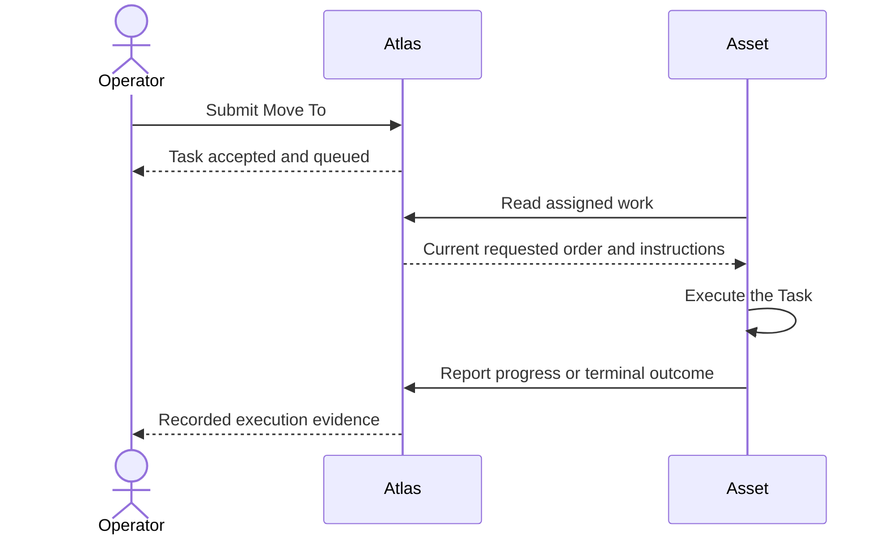

# Tasks

## Story

I ask an Asset to move somewhere. Atlas keeps the request even if the Asset is
offline. I can distinguish work being requested from work actually being done.

## Flow

## Retained decisions to review

- Acceptance is not execution. A lost reply does not prove the request failed.
- The initial commands are Move To, Pause, and Resume. Move To targets coordinates or a saved point.
- An Asset runs one queued Task at a time. Pause and Resume control its queue.
- Cancellation remains a request until the Asset confirms cancellation or reports another outcome.
- Task completion and result-file availability are independent.

## Details when needed

- [Task behavior](../reference/current-design/tasks/tasks.md), [commands](../reference/current-design/tasks/commands.md), and [Pause and Resume](../reference/current-design/tasks/controls.md).
- [Messages](../reference/current-design/tasks/messages.md), [execution evidence](../reference/current-design/tasks/execution-evidence.md), and [read fields](../reference/current-design/tasks/read-format.md).
- [Assigned-read storage](../reference/current-design/tasks/assigned-read-storage.md) is an old implementation detail.
- [Assets](../entities/assets/README.md), [Geofeatures](../entities/geofeatures/README.md), and [Objects](../objects/README.md).

[Atlas planning](../README.md)
