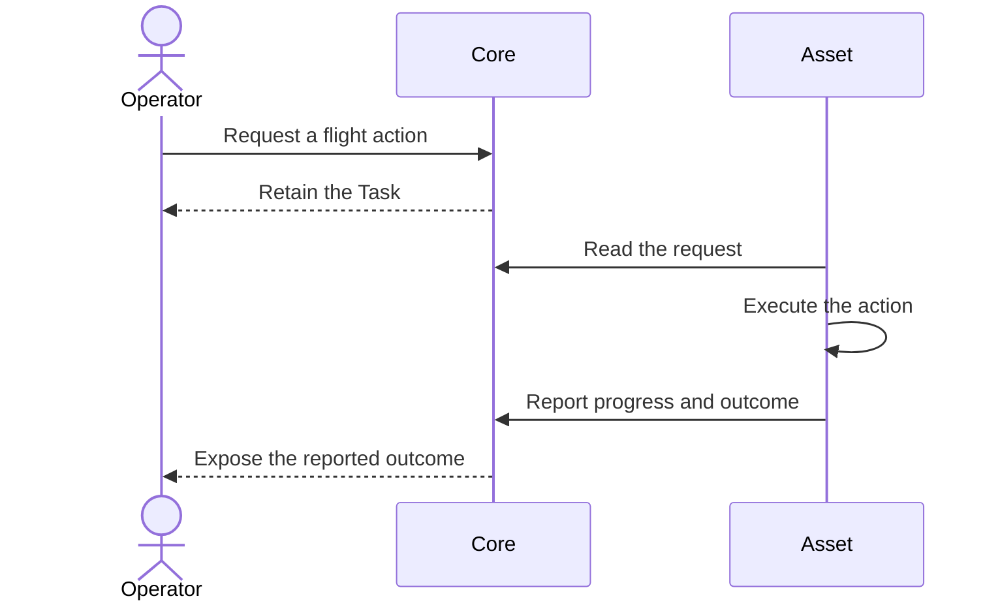

# Tasks

## Story

I ask a drone to Takeoff, Move To a location, and Land. I see what I requested
separately from what the drone reports doing. I also want to point a camera without
making flight and equipment control one indistinguishable action.

## First flight flow

## Selected direction

- The first scenario requests Takeoff, then Move To, then Land.
- Acceptance is not execution. Cancellation remains a request until its effect is evidenced.
- Reconnecting later does not expire pending movement merely because time passed.
- Retrying a request must not create another command. Uncertain execution must not be repeated automatically.
- The Asset decides how waypoint edits affect work already accepted.
- Task completion and [result-file availability](../objects/README.md) remain separate.

## Open

Command fields for Takeoff and Land are not defined here. Flight sequencing,
independent equipment commands, conflicts, and Land during Move To need explicit
stories. What should a failed or cancelled action do to the remaining requests?
This plan does not select a scheduling framework.

[Subsystem planning](../README.md)
